> **Project in progress — may contain inaccuracies.**

<p align="center">
  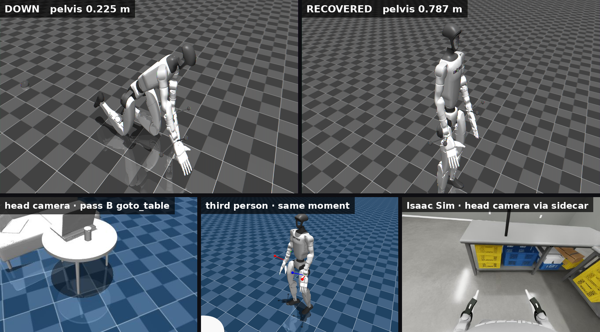
</p>
<p align="center">
  <em>Simulation only. Top: MuJoCo under the SONIC policy, down after an induced fall and
  recovered (pelvis 0.225 → 0.787 m, n=1); the later <code>recover_from_fall</code> verb
  measured prone 10/10 and shoulder-drop 3/3, n=3, harness-limited (section 3). Bottom, left to right: the
  furnished-lounge head-camera frame the model captured at the end of pass B's
  <code>goto_table</code>; the third-person view at that moment (the model judged itself
  0.37 m from the table; measured 1.01 m); an Isaac Sim head-camera frame served through
  the ZMQ sidecar. The hardware results below are text and telemetry — no photograph or
  video of the physical robot is published in this repository.</em>
</p>

# PhysicalAgent

One `RobotAdapter` interface with four robot bodies behind it — a tabletop
humanoid, a hexapod, a quadruped and a 35 kg Unitree G1 under NVIDIA SONIC —
and a typed safety layer between them and Google Gemini Robotics-ER. Gemini has
driven **two of the four on hardware**: the quadruped and the G1.

**1,753 offline tests**, and every measured number below cites the file it comes
from — indexed claim by claim in **[`docs/EVIDENCE.md`](docs/EVIDENCE.md)**.

---

## What it does

- **One tool surface, four bodies.** Gemini plans and calls tools; a typed safety
  layer clamps every call; a per-robot `RobotProfile` decides what that body may
  be asked to do at all.
- **Safety is structural, not advisory.** A robot that declares no supervision
  story cannot be given motion tools — that raises at construction, and the rule
  is enforced again at the tool boundary.
- **Every transport has a `Fake` variant.** The whole system runs, and is tested,
  with no robot, no network and no API key.
- **Evidence is committed next to the claim.** Several results in this repository
  are retractions of earlier results by the same author, with the traces that
  forced them.

---

## Results

| # | Result | Where it ran | Headline number |
|---|---|---|---|
| [1](#1-gemini-robotics-er-2-drove-a-physical-unitree-g1) | Gemini Robotics-ER 2 drove a physical Unitree G1 | **hardware** | 18 tool calls, round trips 10.1–31.3 s |
| [2](#2-a-215-cmin-near-miss-and-the-guard-it-produced) | A 215 °C/min near-miss, and the guard it produced | **hardware** | 65 → 106 °C in 11.5 s; guard fired for real the next day |
| [3](#3-getting-a-fallen-robot-up--and-why-the-obvious-command-is-a-trap) | Getting a fallen robot up — and why the obvious command is a trap | MuJoCo | `recover_from_fall` 10/10 prone; `idle` from prone drags 1.99 m |
| [4](#4-the-ab-report-that-withdrew-two-of-its-own-four-rows) | The A/B report that withdrew two of its own four rows | MuJoCo | reported 0.37 m, measured 1.01 m |
| [5](#5-the-isaac-get-up-ab-voided--the-vendor-mode-never-drove-the-legs) | The Isaac get-up A/B, voided — the vendor mode never drove the legs | Isaac Sim | 14 of 29 joints reachable; ratios −0.76 vs 0.85 |
| [6](#6-the-isaac-outcome-is-decided-by-time-scale-versus-1rtf) | The Isaac outcome is decided by time-scale versus 1/RTF | Isaac Sim | 3.4 against 3.44 needed |
| [7](#7-gemini-driving-a-physical-hiwonder-quadruped-end-to-end) | Gemini driving a physical HiWonder quadruped, end to end | **hardware** | battery-sag abort at 11 053 mV, in the field |
| [8](#8-two-more-robot-bodies-and-what-each-one-actually-evidences) | Two more robot bodies, and what each one actually evidences | **hardware** | snapshot 10/10 byte-distinct frames vs stream 1/10; vision still unproven |

---

### 1. Gemini Robotics-ER 2 drove a physical Unitree G1

**2026-08-20, hardware session.** The operator typed natural-language
tasks; `gemini-robotics-er-2-preview` planned and issued the tool calls; SONIC
executed them on the real robot, under the banner *"SONIC holds balance; ER only
calls the tools above it."*

| What | Measured |
|---|---|
| Typed inputs / tool calls | 7 / 18 in the session; **11 calls transcribed call-by-call** |
| Round trips | 10.1 s – 31.3 s |
| `task wave hi` | `set_arms(wave_right)`, `set_arms(neutral)` — 16.9 s |
| `task change through the poses you know` | `set_arms(arms_out)`, `set_arms(arms_up)`, `set_arms(carry)`, `set_arms(neutral)` — 31.3 s |
| `walk foward 1 meter` (no `task` prefix; operator's typo, quoted verbatim) | **refused** by the argument-count guard, before any model call |

**Said plainly: the robot stayed in its gantry harness throughout.** Its legs
stepped in the air with no forward translation — the model's own narration says
"its legs moved in the air to simulate the steps, but it did not translate
forward in space". And `set_grasp(hand=both, grasp=index_point, strength=firm)`
**failed** — *"finger grasp control is currently unavailable"* — so **no grasp
occurred**.

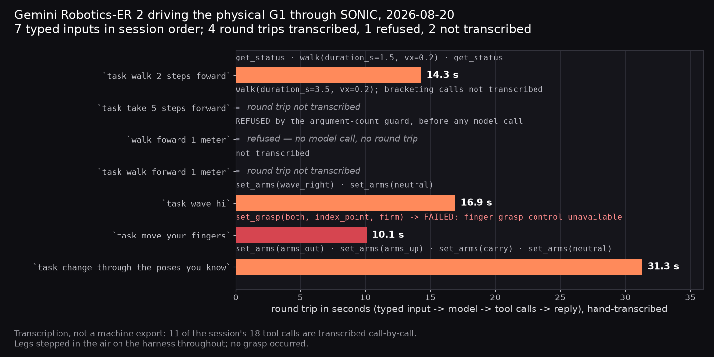

*Hand-transcribed round-trip time per typed task, with the tool calls ER-2 issued —
4 of the 7 typed inputs are timed; one was refused before any model call, and two
are not transcribed call-by-call. The
refused `walk foward 1 meter` and the FAILED `set_grasp` are marked. Source:
[`docs/evidence/er2-hardware-toolcalls-2026-08-20.md`](docs/evidence/er2-hardware-toolcalls-2026-08-20.md).*

> Evidence: [`docs/evidence/er2-hardware-toolcalls-2026-08-20.md`](docs/evidence/er2-hardware-toolcalls-2026-08-20.md)
> and [`docs/evidence/hardware-2026-08-20-er2-driving.md`](docs/evidence/hardware-2026-08-20-er2-driving.md).
> The ~14 GB DDS capture behind the session is archived **offline and is not in
> this repository**, and the screen recording is deliberately unpublished (it
> shows a hostname, home paths and a LAN address). So the tool-call table is
> a **hand transcription**, labelled as one in the file, and it is the weakest
> evidence here: 11 of the 18 calls are transcribed call-by-call, the rest are
> marked *not transcribed* rather than reconstructed.

The day before, **2026-08-19**, the same G1 — also harness-held — stepped under
SONIC from typed manual walk commands while hoisted: **net pelvis displacement
0.19 m across two control windows totalling 632 s** (419 s + 213 s), a figure
confounded by pendulum motion, while holding commanded arm poses.
Authority was measured as any non-zero `kp` in `rt/lowcmd`: **peak kp 99, kd 6.3
across 35 motors, feed-forward torque 0 throughout** — a pure position
controller. Because the robot was hoisted, pelvis velocity includes gantry
pendulum motion, so the peak 0.42 m/s is *not* a gait measurement, and the
write-up says so: *"no clean locomotion speed measurement exists yet."*

> Evidence: [`docs/evidence/hardware-2026-08-19-g1-sonic.md`](docs/evidence/hardware-2026-08-19-g1-sonic.md)

---

### 2. A 215 °C/min near-miss, and the guard it produced

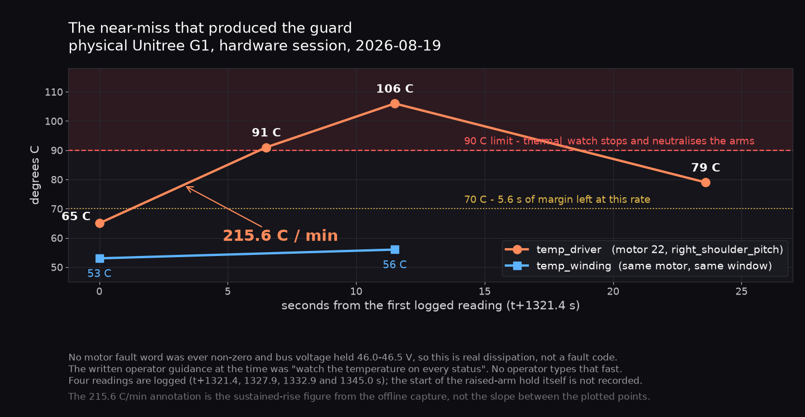

*Motor 22's driver-stage sensor against the winding sensor on the same motor,
plotted from the four logged readings in
[`docs/evidence/hardware-2026-08-19-g1-sonic.md`](docs/evidence/hardware-2026-08-19-g1-sonic.md);
t = 0 is the first logged reading (t+1321.4 s), not the start of the hold. The
215.6 °C/min annotation is the sustained-rise figure computed from the offline
capture (table in the same write-up), not the slope between the plotted points.*

Motor 22 (`right_shoulder_pitch`) went **65 → 91 → 106 °C in 11.5 s** while
holding a raised arm. Over the same window the *winding* sensor moved only
53 → 56 °C. The guard trips on max(winding, driver) per motor (`thermal_verdict`,
`max_c` in `physicalagent/robots/sonic_telemetry.py`), so the fast-moving driver
sensor is the one that reaches 90 °C first: the driver stage has almost no thermal
mass, so it is the first thing to get hot. Nothing in the guard ignores the
winding sensor. No motor fault
word was ever non-zero and bus voltage held 46.0–46.5 V, so this was real
dissipation, not a fault code.

The operator guidance in force at the time — *"watch the temperature on every
`status`"* — was **measurably wrong**: at 215.6 °C/min there are 5.6 s between
70 °C and the 90 °C limit, and no operator types that fast. `thermal_watch` now
runs on its own thread at 0.2 s and acts without being asked.

**And it fired for real the next day.** On 2026-08-20 at 12:02 the watch tripped
live at 90 °C and aborted the 12:00 battery run 20 s in, without being asked to
— a guard designed from one measurement, stopping a run on its own the following
morning. Its action — stop and arms to neutral — did not remove the load on the
ankle that tripped it, which is why an escalation to damp was written and tested
the same day ([`hardware-2026-08-20-er2-driving.md`](docs/evidence/hardware-2026-08-20-er2-driving.md),
HW-DAY2-PLAN outcome).

> Evidence: [`docs/evidence/hardware-2026-08-19-g1-sonic.md`](docs/evidence/hardware-2026-08-19-g1-sonic.md) ·
> [`docs/evidence/hardware-2026-08-20-er2-driving.md`](docs/evidence/hardware-2026-08-20-er2-driving.md)
> (run table, 12:00; "thermal watch fires for real — DONE, live at 90 °C, 12:02") ·
> [`scripts/g1_sonic_session.py`](scripts/g1_sonic_session.py) (`thermal_watch`, `thermal_watch_step`,
> `_thermal_limit`) · `batteries/sim_match_v1.txt` caps raised-arm holds at 8 s
> for this reason.

---

### 3. Getting a fallen robot up — and why the obvious command is a trap

*Simulation only (MuJoCo, SONIC policy).*

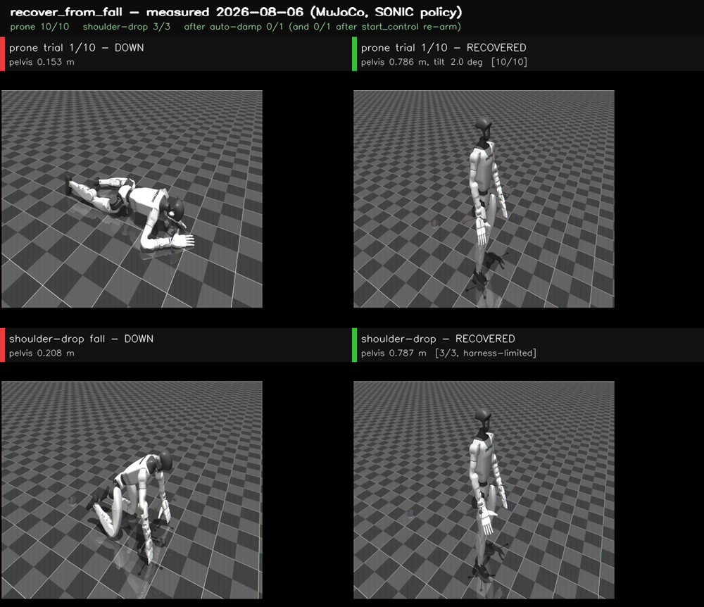

*`recover_from_fall`, measured 2026-08-06 in MuJoCo under the SONIC policy: a
prone trial and a shoulder-drop fall, each shown DOWN and RECOVERED, with the
tallies from the three trial files named below; panel figures quote each trial's
own record in `trials-run1-prone10-realfall2.jsonl`. "harness-limited" means the
shoulder-drop series stopped at three because the robot drifted out of the sim
harness's band and the band refused to re-engage, not because a trial failed
([`artifacts/getup_verb/README.md`](artifacts/getup_verb/README.md)).*

"Standing" was defined **before the reported runs** (runs 2–4) as pelvis ≥ 0.70 m
**and** only feet touching the floor **and** feet actually on the floor, sustained
3 s — all three clauses exist because a robot hanging in the sim's band reads
0.96 m with no contacts. The foot-contact clause was added after run 1 was voided
(a robot flailing in mid-air read as standing); the harness-bug note in
[`artifacts/getup-2026-08-02.md`](artifacts/getup-2026-08-02.md) records it.

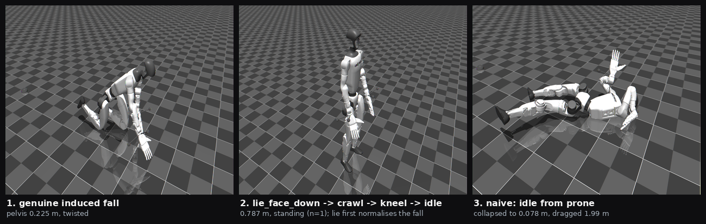

*MuJoCo frames from `artifacts/getup/`: the induced fall (pelvis 0.225 m), the
same robot standing after `lie_face_down → crawl → kneel → idle` (0.787 m, n=1),
and the end state of `idle` straight from prone (collapsed to 0.078 m, dragged
1.99 m).*

| route | trajectory (pelvis, m) | outcome |
|---|---|---|
| kneel ladder | 0.154 → 0.416 → 0.786 | stood up |
| crawl route | 0.152 → 0.449 → 0.421 → 0.787 | stood up |
| genuine induced fall | 0.225 → 0.151 (`lie_face_down` normalises) → 0.431 → 0.410 → 0.787 | stood up (n=1) |
| **`idle` straight from prone** | thrashed to 0.550, collapsed to **0.078**, **dragged 1.99 m** | failed, and made it worse |
| `jump_forward`, 8 s bout | **0 of 438 samples contact-free** | does not jump at its vendor operating point |

The action space contains both working routes and catastrophic ones, and nothing
in the interface tells them apart — that knowledge exists only as measurement.
The later `recover_from_fall` verb measured **prone 10/10, shoulder-drop 3/3** of the falls that could be induced
(n=3; the other eight trials either failed to drop a shoulder or could not
re-engage the band — harness-limited), **and 0/1 after auto-damp** — and 0/1 again
after a `start_control` re-arm, the single retry recorded in the same trial file.

> Evidence: [`artifacts/getup-2026-08-02.md`](artifacts/getup-2026-08-02.md) · `artifacts/getup/*.png` ·
> `artifacts/getup/run{2,3,4}_getup_log.jsonl` ·
> [`docs/evidence/getup-verb-2026-08-06.png`](docs/evidence/getup-verb-2026-08-06.png). The verb tally comes from three
> named files — [`artifacts/getup_verb/trials-run1-prone10-realfall2.jsonl`](artifacts/getup_verb/trials-run1-prone10-realfall2.jsonl),
> [`trials-run2-realfall.jsonl`](artifacts/getup_verb/trials-run2-realfall.jsonl) and [`trials-run3-afterdamp.jsonl`](artifacts/getup_verb/trials-run3-afterdamp.jsonl); what every
> other file in that directory is, including a later aborted run, is listed in
> [`artifacts/getup_verb/README.md`](artifacts/getup_verb/README.md).

---

### 4. The A/B report that withdrew two of its own four rows

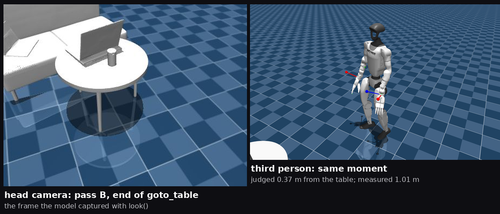

*Pass B, end of `goto_table`: left, the head-camera frame the model captured with
`look`; right, the third-person view at the same moment. The model judged itself
0.37 m from the table; the measured distance to the nearest collision-mesh vertex
is 1.01 m.*

`describe_scene` reported each furniture body's **origin**. In a photo-reconstructed
scene every body keeps the source scan's origin while the *mesh* carries the
offset — so the white table's reported position was **0.99 m** from the table,
the thermos **0.91 m** horizontally and **0.51 m** vertically, the bench
**1.72 m**. Four of five origins sat within ~2 cm of each other at z ≈ 0: the
model was told the bench, the table, both laptops and the thermos were all in the
same place, on the floor.

Every consequence was re-measured rather than argued:

| row | what it was reported as | what it actually was |
|---|---|---|
| `goto_table` | "0.36 m / 0.37 m from the table" | **1.04 m / 1.01 m** to the nearest collision-mesh vertex — and neither robot translated during the task (pass A made zero locomotion calls; pass B's single `goto_object` turned in place, `final_heading_error_deg: −10.8`, and returned start = goal = end, `distance_at_start_m: 0.0`) |
| `pick_thermos` | a grasp failure | a **placement** failure: object 1.08–1.24 m away, top at z = 0.543, arm reach 0.587 m from the shoulder — zero hand contacts was geometrically guaranteed before the first `reach_to` |

In pass B, 8 of its 16 `reach_to` calls were correctly refused by the reachability
check (pass A: 3 of 5). The
model's own text claiming it "walked to the white round table" is **kept in the
committed trace** as evidence of the failure mode. **No grasp was achieved**:
`hand_contacts` 0, `lift_m` 0.001 and 0.004 — millimetre settling noise, not
lift. The physics was correct throughout; only the reporting channel was wrong.

> Evidence: [`artifacts/lounge_scene/REPORT.md`](artifacts/lounge_scene/REPORT.md) ·
> `artifacts/lounge_scene/pass{A,B}/{battery.jsonl,summary.json,*_reply.txt}`.
> The furnished scene comes from a separate, unpublished reconstruction tool of
> the same author — see [THIRD_PARTY_NOTICES.md](THIRD_PARTY_NOTICES.md) §2.

---

### 5. The Isaac get-up A/B, voided — the vendor mode never drove the legs

The vendor's `dds_wholebody` mode is an XR-teleop hybrid: the **legs run the
simulator's own in-sim `policy.onnx`**, the waist is pinned to defaults, and the
external controller's `rt/lowcmd` reaches only the **14 arm joints**, with the
message's `kp`/`kd` parsed and discarded. The mode was believed to be driving the
legs from the first Isaac get-up attempt (2026-08-07,
[`artifacts/getup_verb/isaac-prone-20260807.log`](artifacts/getup_verb/isaac-prone-20260807.log),
itself a 0/1) until the wiggle test of 2026-08-12 — which is why every Isaac result
taken in that window, including the get-up A/B, was **voided rather than reported**.

The wiggle test is the whole result. Command a pose, then read back what the
joints actually did — same eight joints, same targets, the two modes side by
side:

| commanded joint | target (rad) | full-body (patch 05) | vendor `dds_wholebody` |
|---|---|---|---|
| `left_hip_pitch` | −0.25 | −0.213 (**×0.85**) | +0.190 (**×−0.76**, wrong way) |
| `left_knee` | +0.30 | +0.293 (**×0.98**) | −0.329 (**×−1.1**, wrong way) |
| `right_knee` | −0.20 | −0.210 (**×1.05**) | −0.309 (×1.54) |
| `right_ankle_pitch` | +0.15 | +0.148 (**×0.99**) | +0.197 (×1.31) |
| `waist_yaw` | +0.35 | +0.291 (**×0.83**) | −0.002 (**pinned, ×−0.0**) |
| `left_shoulder_pitch` | −0.40 | −0.312 (×0.78) | −0.353 (×0.88) |
| `left_wrist_yaw` | +0.50 | +0.492 (×0.98) | +0.486 (×0.97) |
| `right_elbow` | +0.45 | +0.432 (×0.96) | +0.474 (×1.05) |

The arms track in both modes. The legs and the waist only track in one of them —
and in the vendor mode the legs' apparent response is the in-sim policy doing its
own thing, which is why two of them move *against* the command.

Patch 05 routes all **29 body joints by joint name**, with the order pinned
against the deploy binary's `policy_parameters.hpp`, and writes the message's
per-joint `kp`/`kd` into the PhysX drives. Without the env var the vendor
behaviour is byte-identical; both modes announce themselves at startup; and the
launcher hard-fails if the full-body banner is missing.
`tests/test_full_body_patch.py` rebuilds BASE_COMMIT + patches 05–07 and asserts
the result is **byte-identical to the live vendor provider**; it runs only where
`UNITREE_SIM_ROOT` points at the checkout (3 of the 8 skips in the offline suite),
so drift fails there before launch.

**The law learned: wiggle-test the control path open-loop before trusting any
outcome gate.**

> Evidence: [`artifacts/routing/routing-20260818-101450-fullbody.jsonl`](artifacts/routing/routing-20260818-101450-fullbody.jsonl) vs
> [`routing-20260818-101547-vendor.jsonl`](artifacts/routing/routing-20260818-101547-vendor.jsonl) (the table above is read straight out of
> those two files) · [`third_party/unitree-sim-isaaclab-local/README.md`](third_party/unitree-sim-isaaclab-local/README.md) (patch 05) ·
> [`05-sonic-full-body-routing.patch`](third_party/unitree-sim-isaaclab-local/05-sonic-full-body-routing.patch) · [`tests/test_full_body_patch.py`](tests/test_full_body_patch.py)

---

### 6. The Isaac outcome is decided by time-scale versus 1/RTF

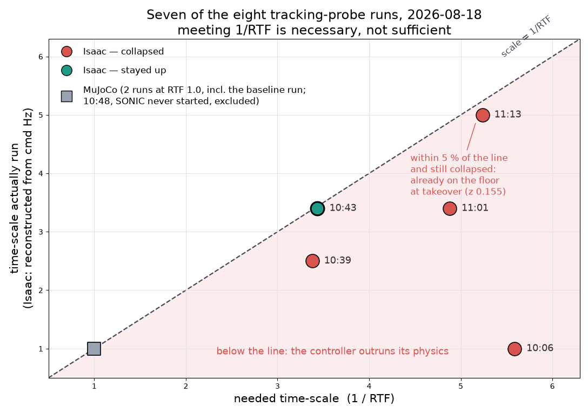

*The `LD_PRELOAD` time-scale each run used against the scale its measured RTF
demanded (1/RTF), for seven of the eight 2026-08-18 runs; the 10:48 MuJoCo run,
in which SONIC never started (RTF −0.026), has no valid needed scale and is
excluded. The Isaac scales are reconstructed from each run's logged command rate
(scale ≈ 500 / cmd Hz), not recorded; plotted from the table in
[`artifacts/tracking/README.md`](artifacts/tracking/README.md).*

Eight probe runs, 2026-08-18. Every Isaac collapse ran a controller faster than
its physics. The only **Isaac** run that stayed up is the one where the
`LD_PRELOAD` time-scale met 1/RTF — **3.4 against 3.44 needed**.

| run | scale | RTF | needed | outcome |
|---|---|---|---|---|
| 10:06 | ~1.0 | 0.179 | 5.59 | collapse |
| 10:39 | ~2.5 | 0.296 | 3.38 | collapse |
| **10:43** | **~3.4** | **0.291** | **3.44** | **stayed up** |
| 11:01 | ~3.4 | 0.205 | 4.88 | collapse |
| 11:13 | ~5.0 | 0.191 | 5.24 | collapse |

*The five Isaac runs of the eight; `needed` is 1/RTF to two decimals. The Isaac
`scale` column is reconstructed from the logged command rate (scale ≈ 500 / cmd Hz),
not recorded — the probe now logs `run_config` so later runs need no reconstruction.
The other three are MuJoCo at scale 1.0 — two at RTF 1.000, including the 10:52
baseline row the 0.0002 figure below comes from, and the 10:48 run in which SONIC never
started; the full eight-run table is in [`artifacts/tracking/README.md`](artifacts/tracking/README.md).*

Necessary, not sufficient: run 11:13 came within 5 % of the needed scale and
still collapsed, because it was **already on the floor before SONIC's first
command landed** (takeover pelvis z 0.155, against 0.752 for the run that stayed
up). And the report is explicit that **"stayed up" is not "stood"**: that run's
pelvis wandered 0.808–0.998 m with std 0.0499 against the MuJoCo baseline's
**0.0002**, and its legs churned at 4.074 rad/s against the baseline's 0.008.

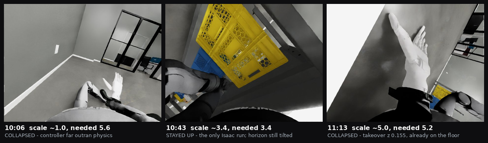

*Isaac Sim head-camera frames from three of the five Isaac runs
(`artifacts/tracking/stand-*.jpg`); the room is the simulator's stock scene, not
a real one.*

> Evidence: [`artifacts/tracking/README.md`](artifacts/tracking/README.md) (full 8-run table) ·
> `artifacts/tracking/*.jsonl` · [`third_party/unitree-sim-isaaclab-local/07-pin-real-time-factor.patch`](third_party/unitree-sim-isaaclab-local/07-pin-real-time-factor.patch)

---

### 7. Gemini driving a physical HiWonder quadruped, end to end

Proven on hardware, with an operator at the stop: the model choosing its own tools,
fusing lidar and camera and reporting honestly; walking under AI control toward a
named object (no distance was recorded; the only measured walk is 28.9 cm at
0.10 m/s, field-run write-up §1b); memory across tasks (*"what did I ask you before?"*
answered correctly); an instant stop that halts the robot **without consulting
the model**; and a battery-sag abort firing in the field at **11 053 mV**
mid-move:

```text
SafetyError: battery sagged to 11053 mV mid-move (floor 11100)
  — motion stopped partway and the robot is halted. The pack cannot
    sustain this load; recharge before moving again.
```

*(Re-typeset: the measured value is quoted in the field-run write-up, the message
template is `physicalagent/robots/rospug.py`, and the 11 100 mV floor is
`BATTERY_MOTION_MIN_MV` in `physicalagent/config.py`.)*

A closed-loop turn hit **−89.9°** on a 90° request early in the session — and was
then **deliberately reverted to open loop**. `rf2o` odometry under-reports
rotation, so closing the loop on it made the robot over-rotate *and* refuse valid
turns. The gait is accurate; only the sensor is wrong. Turns now run on a
duration calibrated for the measured **~122 % over-turn**, with odometry kept as
a gross-overshoot monitor — a role it is safe in precisely *because* it
under-reports.

> Evidence: [`docs/evidence/hardware-2026-07-21-rospug-field-run.md`](docs/evidence/hardware-2026-07-21-rospug-field-run.md)

---

### 8. Two more robot bodies, and what each one actually evidences

**TonyPi (tabletop humanoid) — the vision path, measured on the physical robot.**
The adapter's chain is `look()` → Gemini describes the frame → `do_action()`, and
the half of it this repository *evidences on hardware* is the camera path, whose
stale endpoint had to be identified first: `?action=snapshot` returns **10/10
byte-distinct JPEGs** on a healthy robot while `?action=stream` returns **1/10,
byte-identical** — so the endpoint that looks live is the stale one. The same
docstring records that no two frames differing in *content* have yet been
observed from this robot, so TonyPi vision is still unproven: what is evidenced
is which endpoint is stale, not a working camera. Frames also arrive 640×960 with
duplicated halves, and `dedupe_frame()` crops before the frame reaches the vision
model. The first version of that measurement was taken on a *wedged* robot and
was backwards for a day; the retraction is kept in the docstring, because a
measurement taken in a failed state describes the failure, not the system.

**MiniHexa (hexapod) — a live BLE capture off the real robot.** The notify
characteristic `ffe2` returned `$8127$65535$` — first field the 2S pack in
millivolts (≈ 8.13 V), second pinned at `0xFFFF`, an unpopulated sensor slot. The
USB framing is different (`A|<mV>&`), so the USB parser reads *nothing* off BLE
and BLE needs its own decoder — one that **fails closed**: a value outside a sane
LiPo window returns `None`, so the battery gate refuses rather than permits, and
the suite asserts specifically that `0xFFFF` must never look like a healthy 65 V
pack. The profile is sensing-first for a physical reason: **a BLE disconnect does
not stop this robot**, so it is `OPERATOR_BOUNDED` and every walk is a short
host-bounded burst that always ends with a stop frame.

> Evidence: [`physicalagent/robots/tonypi_link.py`](physicalagent/robots/tonypi_link.py) (`snapshot()`, the ten-sample
> measurement) · [`tools/tonypi_view.py`](tools/tonypi_view.py) · [`physicalagent/robots/tonypi.py`](physicalagent/robots/tonypi.py) and
> [`tests/test_tonypi_dedupe.py`](tests/test_tonypi_dedupe.py) · [`physicalagent/robots/minihexa_codec.py`](physicalagent/robots/minihexa_codec.py)
> (`parse_ble_battery`) · [`tests/test_minihexa_codec.py`](tests/test_minihexa_codec.py)
> (`TestBleTelemetryDecode`) · [`physicalagent/profiles/minihexa.py`](physicalagent/profiles/minihexa.py)

---

## Architecture

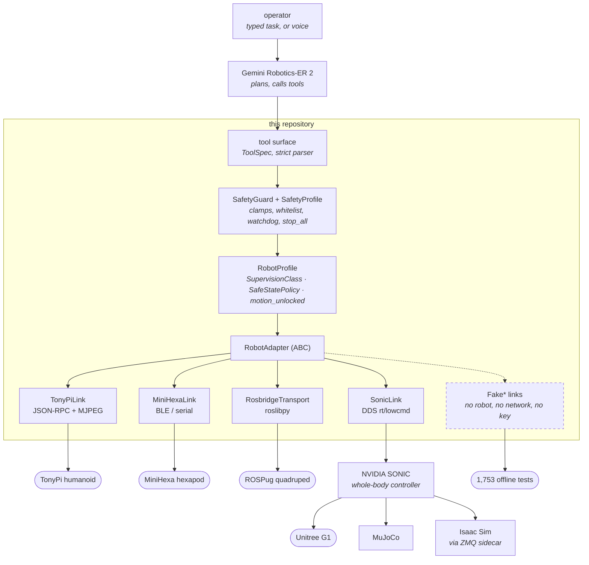

Walking it: the model never touches a transport. Its calls land on a tool surface
with a strict parser — anything the parser cannot map is **refused, never
guessed**. `SafetyGuard` clamps and whitelists; the robot's `RobotProfile`
declares how that body is guaranteed to stop and what "safe" physically means for
it. Only then does a `RobotAdapter` reach a link. Links are dependency-injected,
so every adapter has an offline twin.

Three robots are in the profile registry (`rospug`, `tonypi`, `minihexa`). The G1
is deliberately **not** registered: a registered profile is a promise that the
CLI can build that robot, and a 35 kg biped gets a dedicated session script
([`scripts/g1_sonic_session.py`](scripts/g1_sonic_session.py)) and a tier table frozen by
checksum and pinned by [`tests/test_g1_locomotion_plane.py`](tests/test_g1_locomotion_plane.py)
([`docs/design/g1-safety-tiers.md`](docs/design/g1-safety-tiers.md)) instead.
Machine layout lives in exactly one module, `physicalagent/paths.py`, whose
docstring is the rule: *never re-hardcode a home directory.*

`physicalagent/safety.py` touches **no hardware and no network** — which is why
all of it is unit-testable. `simbridge/sidecar.py` owns its socket end to end and
never touches the simulator's environment; the camera channel is one of the
things it carries, and this is a head-camera frame served through it from
Isaac Sim:

<p align="center">
  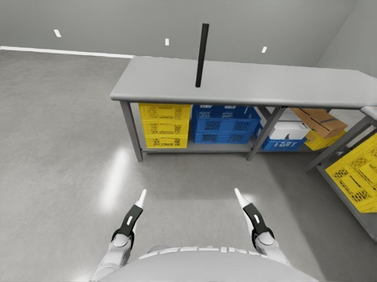
</p>

---

## Engineering highlights

1. **A robot with no supervision story raises at construction.** Every
   `RobotProfile` declares a `SupervisionClass` — how it is guaranteed to stop
   when we stop talking to it (`DEADMAN`, `COMMAND_EXPIRY`, `TETHERED`,
   `OPERATOR_BOUNDED`, `DYNAMIC_HUMANOID`) — and a `SafeStatePolicy` — what safe
   physically means for that body (`FREEZE` for a statically stable quadruped;
   `SETTLE_TO_STANCE` for a biped, because freezing mid-stride is a fall;
   `LOWER_AND_RELEASE` for arms and hands). The check is **doubled at the tool
   boundary**, because the flag once validated a profile that nothing downstream
   consulted — so a sensing-only robot still handed `walk`, `turn` and
   `do_action` to the model. `motion_unlocked` is per-body and defaults to
   locked: it was a single global until a second profile was registered and
   inherited the first robot's field-testing on its very first run.

2. **A `NameError` that fired *after* the robot was already under control.** A
   rewrite removed a module-level import and left one reference behind. **1,554
   tests passed**, because none of them executes the `--start` banner — that line
   runs only after a real link opens. The cost was specific: the crash landed
   *after* `start_control()` succeeded, so SONIC held the robot with no session
   and no thermal watch while `right_ankle_roll` sat at 79 °C. The guard now
   walks the **AST of all five operator scripts** and asserts every global name
   they load is defined. No linter is installed here, so **the test is the
   linter** — and two of its own cases prove it catches this exact failure and
   does not cry wolf.

3. **BLE battery parsing fails closed.** `0xFFFF` must never read as a healthy
   65 V pack. The transport asymmetry is encoded as a *safety fact*, not an
   implementation detail: BLE parses a reduced command set with no per-joint
   control and no action-stop, and **a BLE disconnect does not stop the robot** —
   so that profile is `OPERATOR_BOUNDED` and every walk is a short host-bounded
   burst that always ends with a stop frame.

4. **A DDS domain mismatch found by measurement, not reasoning.** Upstream
   initialised DDS **domain 1** on the default interface while the whole
   controller stack runs **domain 0 on loopback**. Measured 2026-08-06: the
   simulator published `rt/lowstate` at ~80 Hz with real joint values while the
   controller side saw **zero** traffic — a silent, total mismatch. Separately,
   upstream publishes the pelvis IMU quaternion `[x,y,z,w]` while both SONIC and
   the vendor's own MuJoCo bridge read it w-first; on an upright robot
   `[0.0039, −0.0224, −0.0415, 0.9989]` became `[0.9988, 0.0035, −0.0235,
   −0.0438]` after the fix. Both measurements are recorded in
   `third_party/unitree-sim-isaaclab-local/README.md` (patch 01 and patch 02
   entries). The separate before/after files
   `artifacts/isaac_m0/dds-interop-matrix{,-after-fix}.txt` are a different
   measurement — a 2×2 publisher/subscriber matrix (four publisher→subscriber
   pairs) showing that **nothing talks
   across the CycloneDDS 0.11.0 / 11.0.1 boundary**, which is why every DDS
   process under the Isaac stack is pinned to one C core.

5. **A recorder whose failure mode was a plausible-looking empty file.**
   CycloneDDS picks its interface once, at startup. A recorder started while the
   robot link was down bound to Wi-Fi instead and wrote **six zero-byte files for
   34 minutes**; it could never have recovered on its own. `hw_recorder` now
   refuses to start without an interface on the robot's wired subnet, and
   `--iface` does not bypass the check. The wider lesson: start the recorder
   **first** and verify overlap **before** the run — a recorder that starts late
   fails silently, and both processes report success.

6. **A model-driven sweep of 23 never-before-observed robot modes found four
   defects**, each of which had been silently producing false results.

   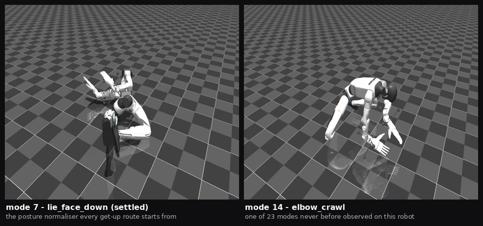

   *MuJoCo renders of two modes from the sweep: mode 7 `lie_face_down` (settled),
   the posture every get-up route starts from, and mode 14 `elbow_crawl`, one of
   the 23 modes never previously observed on this robot.*

   The sharpest: `select_mode` sent `speed = 0.0` whenever the caller named none,
   and the planner reads 0.0 as *stationary* while `−1.0` means *use this mode's
   trained speed*. The tell was that the vendor's own gamepad **cannot produce
   speed 0 on a standing mode**. It affected all 13 styled walks and had **zero
   test coverage** before the fix. Asked to "sneak forward quietly", the model
   called `walk(vx=0.3)` — mode 1, not 18 — so `stealth_walk` was never broken,
   it was never commanded. The numbers are now pinned by a test that re-reads the
   vendor C++ header and fails if they drift.
   (`artifacts/mode-test-2026-08-01.md`, `artifacts/mode*.png`)

7. **Machine layout lives in one module, and a test enforces it.**
   `tests/test_paths.py` walks every `.py` and `.sh` in the tree and fails if any
   file contains a `/home/<user>` path other than the robots' own vendor
   accounts, so no machine name has to appear in the test at all.
   `tools/publish_check.py` applies the same rule to the whole export.

---

## Status

The claim-by-claim index, including a closing list of the claims this repository
deliberately does **not** make, is [`docs/EVIDENCE.md`](docs/EVIDENCE.md).

**Works**
- One adapter interface with four robot bodies behind it; three in the registry.
- Gemini Robotics-ER 2 issuing tool calls to a physical G1 through SONIC, and
  Gemini driving a physical quadruped end to end.
- MuJoCo get-up routes, measured, with a defined standing criterion.
- Isaac Sim bridge with 8 documented patches and a drift test.
- **1,753 tests pass and 8 skip in seconds** (5–6 s on the machine recorded in
  [`docs/EVIDENCE.md`](docs/EVIDENCE.md), 7–15 s on others), fully offline and with no API key set.

**Does not work / was never done**
- **No grasp and no lift, in simulation or on hardware, on any task.**
- **No evidenced walking on either hardware day.** On 2026-08-19 the hoisted robot
  stepped under commanded walks, with a net pelvis displacement of 0.19 m that
  includes pendulum motion; on 2026-08-20 the robot was harnessed and its legs
  stepped in the air.
- **Nothing here trained a policy.** SONIC is NVIDIA's, used as shipped; this
  repository is the tool surface and the safety layer above it.
- Gemini has not driven the tabletop humanoid or the hexapod on hardware — those
  two bodies are evidenced by measurement and adapter tests, not by a driven run.
- Voice was proven on the bench (Bluetooth HFP path, 2026-08-19) and was **never
  wired into a hardware session**.
- No clean locomotion-speed measurement exists while the robot is hoisted.
- No segment-aligned hardware-vs-sim battery capture: the recorder started 20 s
  after the battery's last mark, and `sim_match_compare.py` **correctly refuses**
  with exit 2.
- The Isaac stack cannot run on current hardware and is frozen; its scripts skip
  cleanly when `ISAAC_PY` / `UNITREE_SIM_ROOT` are unset.

**Next**
- Where the out-of-range ankle-pitch target comes from — commanded pitch reaches
  **+1.35/+1.38 rad** against a mechanical limit of **+0.5236 rad**, 2.6× the
  limit, while measured pitch never exceeds +0.17 rad. A persistent 0.3–0.8 rad
  gap at kp 28.5 is 10–15 N·m producing **no motion**: pure resistive heating.
- Whether clamping that command to the real limit lengthens the stride.
- `foot_force` from the 2026-08-20 run — captured, still unanalysed.

---

## Quick start

```bash
cd physicalagent

python -m venv .venv && . .venv/bin/activate
pip install -e ".[dev]"          # add ble, voice, sim as needed

pytest -m "not hardware" -q      # 1,753 tests in seconds: no robot, no network, no key

cp .env.example .env             # only needed to put a model in the loop
```

The test suite is the part that needs nothing. The robot paths need a robot; the
simulation paths need external projects, all located by environment variable and
none of them shipped here:

| What | Needed for | Env var | Degrades to |
|---|---|---|---|
| A Gemini API key | any model-in-the-loop run | `GEMINI_API_KEY` | `Fake` brain; tests unaffected |
| [GR00T-WholeBodyControl / SONIC](https://github.com/NVlabs/GR00T-WholeBodyControl) | the G1, in sim or on hardware | `WBC_ROOT`, `WBC_PY` | G1 paths unavailable |
| [`unitree_sim_isaaclab`](https://github.com/unitreerobotics/unitree_sim_isaaclab) + the 8 patches in `third_party/` | the Isaac bridge | `UNITREE_SIM_ROOT`, `ISAAC_PY`, `ISAAC_CYCLONEDDS_HOME` | Isaac tests skip |
| MuJoCo | the simulation bridge | `pip install ".[sim]"` | sim scenes unavailable |
| A photo-to-MuJoCo scene reconstruction output (a separate, unpublished project of the same author) | the furnished-lounge scene only | `SCENE_SOURCE_ROOT` | flat scene still works |

Then:

```bash
./robot                          # operator console, default robot
./robot doctor --robot minihexa  # preflight only
./robot --robot tonypi           # console against another robot in the registry
```

---

## License

**Source-available. All rights reserved; no licence is granted.** See
[LICENSE](LICENSE) — this is *not* open source, and no licence to copy, modify,
distribute or train on this repository is granted.

Third-party material, what is redistributed and under which terms, and what is
deliberately *not* redistributed: [THIRD_PARTY_NOTICES.md](THIRD_PARTY_NOTICES.md).

A claim-by-claim index of every number above and the file it comes from:
[docs/EVIDENCE.md](docs/EVIDENCE.md). A map of everything else in `docs/`:
[docs/README.md](docs/README.md).
